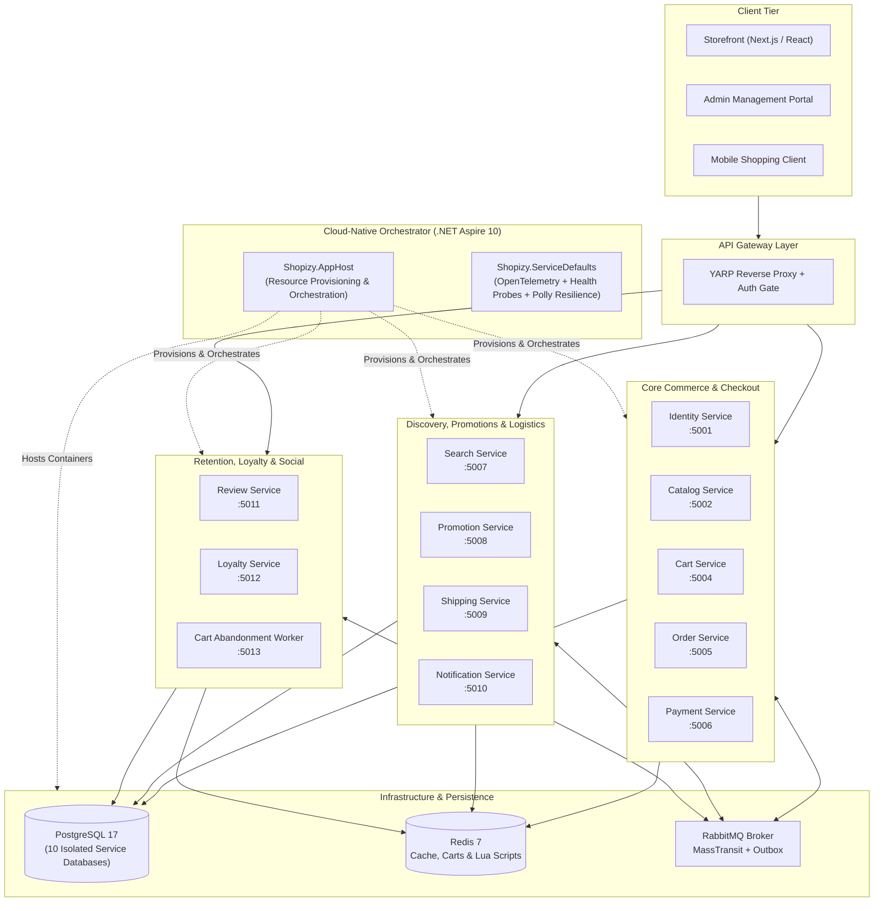

<div align="center">

# 🛍️ Shopizy Microservices Platform

### Enterprise-grade digital commerce platform engineered with .NET 10, Clean Architecture, DDD, and .NET Aspire

[](https://github.com/akazad13/shopizy-microservice/actions)
[](https://dotnet.microsoft.com/)
[](https://learn.microsoft.com/en-us/dotnet/csharp/)
[](src/Shopizy.AppHost)
[](https://www.rabbitmq.com/)
[](https://www.postgresql.org/)
[](LICENSE)

[Overview](#-overview--highlights) •
[Architecture](#-architecture--system-topology) •
[Microservices Ecosystem](#-microservices-ecosystem) •
[Tech Stack](#-technology-stack) •
[Quick Start](#-developer-quick-start) •
[Documentation](#-documentation--specs)

</div>

---

## 📖 Table of Contents

1. [Overview & Highlights](#-overview--highlights)
2. [Key Business Capabilities](#-key-business-capabilities)
3. [Architecture & System Topology](#-architecture--system-topology)
4. [Microservices Ecosystem](#-microservices-ecosystem)
5. [Technology Stack](#-technology-stack)
6. [Module Roadmap & Status](#-module-roadmap--status)
7. [Solution Structure](#-solution-structure)
8. [Developer Quick Start](#-developer-quick-start)
9. [Engineering Principles](#-engineering-principles)
10. [Documentation & Specs](#-documentation--specs)
11. [Contributing](#-contributing)

---

## 🌟 Overview & Highlights

Shopizy is a modern, high-throughput e-commerce platform designed from first principles as an ensemble of independently deployable microservices. Each service encapsulates its own bounded context, database schema, domain models, and API surface, eliminating distributed monolith anti-patterns.

### Architectural Highlights

- **Database-per-Service**: 10 isolated PostgreSQL databases + dedicated Redis instances ensure zero cross-domain table coupling.
- **Asynchronous Event-Driven Messaging**: RabbitMQ + MassTransit power resilient event choreography backed by the Transactional Outbox pattern.
- **Zero Overselling & Hot-Key Protection**: Atomic inventory reservation with 15-minute expiration windows and Redis Lua scripts for flash-sale protection.
- **Enterprise Security**: Multi-tenant customer data isolation enforced at repository queries alongside cryptographic JWT RBAC.
- **Idempotency by Design**: Mutating and financial endpoints enforce standard `Idempotency-Key` headers to guarantee exactly-once execution.
- **End-to-End Observability**: Native OpenTelemetry distributed tracing, metrics, structured Serilog logging, and .NET Aspire dashboard telemetry.

---

## ⚡ Key Business Capabilities

| Capability | Description |
|:---|:---|
| **Atomic Inventory Reservation** | Prevents overselling under high concurrency; automatically restocks abandoned reservations after 15 minutes. |
| **Dimensional Catalog Engine** | Hierarchical categories, brands, parent-variant matrix (SKUs, pricing, stock, JSON specifications), and optimistic concurrency. |
| **Session-Backed Cart** | Redis-powered shopping cart with price snapshotting, live discrepancy warnings, and guest-to-customer cart merging. |
| **Two-Phase Payment & Refunds** | Tokenized payment processing, gateway reconciliation, automated refund lifecycles, and audit records. |
| **Retail Search & Typo Tolerance** | Multi-attribute faceting, Damerau-Levenshtein typo correction, retail synonym expansion, and "Did You Mean?" hints. |
| **Promotions & Campaign Rules** | Coupon codes with safety cap ceilings, minimum spend enforcement, percentage/fixed discounts, and BOGO mechanics. |
| **Logistics & Multi-Carrier Shipping** | Real-time rate calculation (FedEx, UPS, USPS, DHL), automatic $75 free shipping waivers, and milestone tracking. |
| **Real-Time Push & Dispatch** | SignalR web sockets for live order status updates and transactional email notifications. |
| **Verified Social Proof & Wishlists** | 1-5 star ratings with verified buyer badges, helpfulness voting, and customer wishlist collections. |
| **Loyalty Ledger & Digital Gift Cards** | Tiered loyalty point accrual ($1 = 1 point), redemption ($1 discount per 100 points), and gift card balance deduction. |
| **Cart Abandonment Sweeper** | Automated 2-hour inactivity sweeps, 24-hour customer cooldown suppression, and cryptographic recovery URLs. |

---

## 🏗️ Architecture & System Topology



---

## 🧩 Microservices Ecosystem

| # | Service Name | Project Path | Storage / Database | Primary Responsibility |
|:---:|:---|:---|:---|:---|
| **1** | **Shared Kernel** | `src/Shopizy.SharedKernel` | — | Common DDD building blocks, Result<T>, Outbox pattern, and idempotency filter. |
| **2** | **Identity Service** | `src/Shopizy.IdentityService` | `identitydb` (Postgres) | User registration, JWT issuance, refresh tokens, and multi-tenant scoping. |
| **3** | **Catalog Service** | `src/Shopizy.CatalogService` | `catalogdb` (Postgres) | Categories, brands, parent-variant products, pricing, and stock concurrency. |
| **4** | **Cart Service** | `src/Shopizy.CartService` | Redis 7 | Redis-backed cart state, price snapshotting, discrepancy alerts, and guest merges. |
| **5** | **Order Service** | `src/Shopizy.OrderService` | `orderdb` (Postgres) | Atomic reservation, zero-overselling validation, 15-min unpaid expiry, and checkout. |
| **6** | **Payment Service** | `src/Shopizy.PaymentService` | `paymentdb` (Postgres) | Tokenized charge authorization, decline handling, and automated refund ledger. |
| **7** | **Search Service** | `src/Shopizy.SearchService` | Redis / Memory Index | Typo-tolerant search, retail synonyms, "Did You Mean?", and multi-faceted filtering. |
| **8** | **Promotion Service**| `src/Shopizy.PromotionService` | `promotiondb` (Postgres) | Coupon validation, safety cap ceilings, percentage/fixed discounts, and BOGO rules. |
| **9** | **Shipping Service** | `src/Shopizy.ShippingService` | `shippingdb` (Postgres) | Carrier rate quotation (USPS/UPS/FedEx/DHL), $75 waiver, and tracking milestones. |
| **10**| **Notification Service**| `src/Shopizy.NotificationService`| `notificationdb` (Postgres)| Transactional email dispatch, merchant notifications, and SignalR live push hubs. |
| **11**| **Review Service** | `src/Shopizy.ReviewService` | `reviewdb` (Postgres) | 1-5 star reviews, verified buyer badge verification, helpfulness voting, and wishlists. |
| **12**| **Loyalty Service** | `src/Shopizy.LoyaltyService` | `loyaltydb` (Postgres) | Loyalty point accrual ($1=1pt), redemptions (100pt=$1), and digital gift cards. |
| **13**| **Cart Abandonment**| `src/Shopizy.CartAbandonmentWorker`| `abandonmentdb` (Postgres)| Inactivity background sweeper, 24h recipient suppression, and restore tokens. |

---

## 🛠️ Technology Stack

| Layer | Technology | Details |
|:---|:---|:---|
| **Runtime & Language** | .NET 10 / C# 14 | Latest performance enhancements, collection expressions, pattern matching |
| **Architecture Style** | Clean Architecture + DDD + CQRS | Independent Domain, Application, Infrastructure, and Presentation layers |
| **Orchestration** | .NET Aspire 10 | Centralized service discovery, telemetry, and container provisioning |
| **API Framework** | ASP.NET Core 10 Minimal APIs | High-throughput, low-overhead HTTP endpoints with RFC 7807 Problem Details |
| **Relational Database** | PostgreSQL 17 via EF Core 10 | Database-per-service isolation, migrations, and concurrency tokens |
| **Distributed Cache & State** | Redis 7 | Cart sessions, Lua atomicity scripts, and SignalR backplane |
| **Message Broker** | RabbitMQ + MassTransit | Asynchronous integration events with Transactional Outbox pattern |
| **Real-Time Communication** | ASP.NET Core SignalR | Sub-second push delivery for order status and tracking milestones |
| **Resilience & Fault Tolerance** | Polly (`Microsoft.Extensions.Http.Resilience`)| Circuit breakers, retries with exponential backoff, and timeouts |
| **Observability** | OpenTelemetry + Serilog | Distributed tracing, live metrics, and Aspire Telemetry Dashboard |
| **Automated Testing** | xUnit + FluentAssertions | 38 test suites across Unit, Integration, and WebApplicationFactory E2E tiers |
| **Continuous Integration** | GitHub Actions | Automated build (`--warnaserror`), test runner, and Google AI PR review |

---

## 📦 Module Roadmap & Status

All 13 modules across all 3 development phases are fully implemented, verified, and merged:

### Phase 1: Core Commerce & Checkout (MVP)

| # | Module | Branch | Pull Request | Status | Automated Tests |
|:---:|:---|:---|:---:|:---:|:---:|
| 1 | **Shared Kernel & Aspire Orchestrator** | `feature/shared-kernel` | [#1](https://github.com/akazad13/shopizy-microservice/pull/1) | ✅ MERGED | 30 / 30 Passed |
| 2 | **Identity & Access Service** | `feature/identity-service` | [#2](https://github.com/akazad13/shopizy-microservice/pull/2), [#3](https://github.com/akazad13/shopizy-microservice/pull/3) | ✅ MERGED | 48 / 48 Passed |
| 3 | **Product Catalog Service** | `feature/catalog-service` | [#4](https://github.com/akazad13/shopizy-microservice/pull/4) | ✅ MERGED | 62 / 62 Passed |
| 4 | **Shopping Cart Service** | `feature/cart-service` | [#6](https://github.com/akazad13/shopizy-microservice/pull/6) | ✅ MERGED | 38 / 38 Passed |
| 5 | **Order & Inventory Service** | `feature/order-service` | [#7](https://github.com/akazad13/shopizy-microservice/pull/7) | ✅ MERGED | 33 / 33 Passed |
| 6 | **Payment & Refund Gateway** | `feature/payment-service` | [#8](https://github.com/akazad13/shopizy-microservice/pull/8) | ✅ MERGED | 15 / 15 Passed |

### Phase 2: Discovery, Merchandising & Operations

| # | Module | Branch | Pull Request | Status | Automated Tests |
|:---:|:---|:---|:---:|:---:|:---:|
| 7 | **Search & Discovery Engine** | `feature/search-service` | [#9](https://github.com/akazad13/shopizy-microservice/pull/9) | ✅ MERGED | 19 / 19 Passed |
| 8 | **Promotion & Coupon Service** | `feature/promotion-service` | [#10](https://github.com/akazad13/shopizy-microservice/pull/10) | ✅ MERGED | 12 / 12 Passed |
| 9 | **Shipping & Tracking Service** | `feature/shipping-service` | [#11](https://github.com/akazad13/shopizy-microservice/pull/11) | ✅ MERGED | 12 / 12 Passed |
| 10 | **Notification & Real-Time Push** | `feature/notification-service` | [#12](https://github.com/akazad13/shopizy-microservice/pull/12) | ✅ MERGED | 12 / 12 Passed |

### Phase 3: Retention, Loyalty & Social Proof

| # | Module | Branch | Pull Request | Status | Automated Tests |
|:---:|:---|:---|:---:|:---:|:---:|
| 11 | **Reviews, Ratings & Wishlists** | `feature/review-service` | [#13](https://github.com/akazad13/shopizy-microservice/pull/13) | ✅ MERGED | 17 / 17 Passed |
| 12 | **Loyalty Points & Gift Cards** | `feature/loyalty-service` | [#14](https://github.com/akazad13/shopizy-microservice/pull/14) | ✅ MERGED | 20 / 20 Passed |
| 13 | **Abandoned Cart Recovery Worker** | `feature/cart-abandonment-worker` | [#15](https://github.com/akazad13/shopizy-microservice/pull/15) | ✅ MERGED | 22 / 22 Passed |

**Total Test Coverage:** 336 passing tests across 38 distinct test projects (100% pass rate).

---

## 📁 Solution Structure

```
shopizy-microservice/
├── src/                                       # Production microservice projects
│   ├── Shopizy.SharedKernel/                  # Cross-cutting DDD domain primitives & contracts
│   ├── Shopizy.ServiceDefaults/               # OpenTelemetry, health checks, resilience defaults
│   ├── Shopizy.AppHost/                      # .NET Aspire 10 cloud-native local orchestrator
│   ├── Shopizy.IdentityService/               # Auth, JWT, user accounts, customer isolation
│   ├── Shopizy.CatalogService/                # Categories, brands, variants, stock concurrency
│   ├── Shopizy.CartService/                   # Redis cart store, snapshotting, discrepancy alerts
│   ├── Shopizy.OrderService/                  # Zero-overselling atomic reservations, orders
│   ├── Shopizy.PaymentService/                # Payment gateway, refunds, transaction audit
│   ├── Shopizy.SearchService/                 # Typo-tolerant search, synonyms, facets
│   ├── Shopizy.PromotionService/              # Discount rules, coupon campaigns, BOGO logic
│   ├── Shopizy.ShippingService/               # Carrier quote engine, $75 waiver, tracking
│   ├── Shopizy.NotificationService/           # Email dispatcher, SignalR real-time hubs
│   ├── Shopizy.ReviewService/                 # Ratings, verified buyer badge, wishlists
│   ├── Shopizy.LoyaltyService/                # Loyalty ledger, points accrual, gift cards
│   └── Shopizy.CartAbandonmentWorker/         # Inactivity sweeper, restore token generator
├── tests/                                     # 38 Automated test projects (Unit, Integration, E2E)
│   ├── Shopizy.*.UnitTests/                   # Domain logic, value object, and state machine tests
│   ├── Shopizy.*.IntegrationTests/            # EF Core persistence, Redis, and event broker tests
│   └── Shopizy.*.E2ETests/                    # Full HTTP WebApplicationFactory API contract tests
├── .specify/                                  # Architectural specifications & engineering memory
│   ├── architecture/                          # System architecture & module decomposition
│   ├── memory/constitution.md                 # 8 non-negotiable engineering principles
│   └── specs/                                 # Formal module specs, plans, tasks, and audit logs
├── .agents/                                   # Antigravity autonomous development skills
├── .github/                                   # CI workflows and Google AI PR review scripts
└── docs/                                      # Operational runbook, PRD, and workflow guide
```

---

## 🏃 Developer Quick Start

### 1. Prerequisites

- **[.NET 10 SDK](https://dotnet.microsoft.com/download/dotnet/10.0)** (v10.0.100+)
- **[Docker Desktop](https://www.docker.com/)** or Podman (required for Aspire container provisioning)
- **Git** & **[GitHub CLI (`gh`)](https://cli.github.com/)**

### 2. Clone & Build

```bash
git clone https://github.com/akazad13/shopizy-microservice.git
cd shopizy-microservice

# Restore packages & build entire solution with zero warnings allowed
dotnet restore Shopizy.sln
dotnet build Shopizy.sln --warnaserror
```

### 3. Run Automated Tests

Execute the complete 38-project test suite locally:

```bash
dotnet test Shopizy.sln
# Expected: 336 passed, 0 failed (100% pass rate)
```

### 4. Run Locally with .NET Aspire

Launch the entire ecosystem with a single command:

```bash
dotnet run --project src/Shopizy.AppHost
```

This automatically:
- Provisions containerized **PostgreSQL 17** with 10 separate service databases.
- Provisions containerized **Redis 7** for cart state, caching, and pub/sub.
- Provisions containerized **RabbitMQ** for event messaging.
- Starts all 13 microservices with automatic service discovery.
- Opens the **.NET Aspire Telemetry Dashboard** at `https://localhost:15888` for live logs, traces, and metrics.

---

## 📜 Engineering Principles

The Shopizy platform strictly adheres to **8 non-negotiable engineering principles** documented in [`.specify/memory/constitution.md`](.specify/memory/constitution.md):

| # | Principle | Enforcement Rule |
|:---:|:---|:---|
| **I** | **Clean Architecture** | The Domain layer contains zero dependencies on ORMs, web frameworks, or third-party packages. |
| **II** | **Zero Overselling** | Stock reservation is atomic; 15-minute unpaid expiry and restocking are mandatory. |
| **III**| **Event-Driven Decoupling** | Synchronous cross-service writes are prohibited; services communicate via Transactional Outbox events. |
| **IV** | **Test-First Quality** | Every specification defines unit, integration, and E2E acceptance criteria prior to implementation. |
| **V** | **Zero Trust Security** | JWT Bearer authentication is mandatory; customer data isolation is strictly enforced at query level. |
| **VI** | **Idempotency** | All mutating and financial endpoints require and validate standard `Idempotency-Key` headers. |
| **VII**| **Database-per-Service** | Direct cross-database queries and foreign keys are forbidden; each service fully owns its data store. |
| **VIII**|**Hot-Key Inventory** | High-contention flash-sale inventory operations are safeguarded by atomic Redis Lua scripts. |

---

## 📚 Documentation & Specs

### System & Architecture Documentation

| Document | Purpose |
|:---|:---|
| [Operations & Incident Runbook](docs/RUNBOOK.md) | Local setup, ports, configuration keys, database migrations, and incident troubleshooting playbooks. |
| [Shopizy PRD](docs/Shopizy_PRD.md) | Comprehensive Product Requirements Document defining business scope and requirements. |
| [SDD Workflow Guide](docs/sdd-workflow-guide.md) | Complete guide to the 7-stage Spec-Driven Development SDLC lifecycle and autonomous agent loops. |
| [System Architecture Blueprint](.specify/architecture/system-architecture.md) | Full architectural topology, CQRS design, and technology rationale. |
| [Module Decomposition Roadmap](.specify/architecture/module-decomposition.md) | 13-module dependency graph, integration contracts, and E2E scenario definitions. |
| [Project Constitution](.specify/memory/constitution.md) | The 8 non-negotiable engineering laws governing all architecture and code reviews. |

### Module Specifications & Audit Logs

| Module | Specification | Audit Trail & Test Log |
|:---|:---|:---|
| **Module 1: Shared Kernel** | [Spec](.specify/specs/shared-kernel/spec.md) | [Review Log](.specify/specs/shared-kernel/review-log.md) |
| **Module 2: Identity Service** | [Spec](.specify/specs/identity-service/spec.md) | [Review Log](.specify/specs/identity-service/review-log.md) |
| **Module 3: Catalog Service** | [Spec](.specify/specs/catalog-service/spec.md) | [Review Log](.specify/specs/catalog-service/review-log.md) |
| **Module 4: Cart Service** | [Spec](.specify/specs/cart-service/spec.md) | [Review Log](.specify/specs/cart-service/review-log.md) |
| **Module 5: Order Service** | [Spec](.specify/specs/order-service/spec.md) | [Review Log](.specify/specs/order-service/review-log.md) |
| **Module 6: Payment Service** | [Spec](.specify/specs/payment-service/spec.md) | [Review Log](.specify/specs/payment-service/review-log.md) |
| **Module 7: Search Service** | [Spec](.specify/specs/search-service/spec.md) | [Review Log](.specify/specs/search-service/review-log.md) |
| **Module 8: Promotion Service** | [Spec](.specify/specs/promotion-service/spec.md) | [Review Log](.specify/specs/promotion-service/review-log.md) |
| **Module 9: Shipping Service** | [Spec](.specify/specs/shipping-service/spec.md) | [Review Log](.specify/specs/shipping-service/review-log.md) |
| **Module 10: Notification Service** | [Spec](.specify/specs/notification-service/spec.md) | [Review Log](.specify/specs/notification-service/review-log.md) |
| **Module 11: Review Service** | [Spec](.specify/specs/review-service/spec.md) | [Review Log](.specify/specs/review-service/review-log.md) |
| **Module 12: Loyalty Service** | [Spec](.specify/specs/loyalty-service/spec.md) | [Review Log](.specify/specs/loyalty-service/review-log.md) |
| **Module 13: Cart Abandonment** | [Spec](.specify/specs/cart-abandonment-worker/spec.md) | [Review Log](.specify/specs/cart-abandonment-worker/review-log.md) |

---

## 🤝 Contributing

We welcome contributions! All work follows the repository's Spec-Driven Development (SDD) lifecycle and adheres to the [Project Constitution](.specify/memory/constitution.md). 

For step-by-step guidance on creating specifications, running the generator/reviewer loop, executing test verification, and automated PR reviews, refer to the [SDD Workflow Guide](docs/sdd-workflow-guide.md).

---

## 👤 Author

**Md. Abul Kalam**
- GitHub: [@akazad13](https://github.com/akazad13)
- LinkedIn: [Md. Abul Kalam](https://linkedin.com/in/akazad13)

---

## 📄 License

This project is licensed under the [MIT License](LICENSE).

